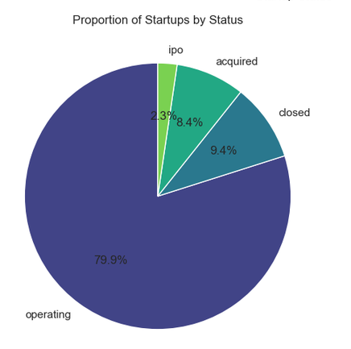

# Startup Funding and Status Analysis

## Overview

Explores how startup funding and recorded company status vary across businesses. The analysis examines data quality, funding distributions, and class balance to inform a future predictive model.

## Data Source

The analysis uses the Startup Success Prediction dataset available
on [Kaggle](https://www.kaggle.com/datasets/lolaosama/big-startup-secsees).

The dataset is included in this repository at
`data/big_startup_secsees_dataset.csv`. It contains funding,
industry, location, and recorded status information for 66,368 businesses.

## Questions

- How is total funding distributed across startups?
- What proportion of businesses have each recorded status?
- How does funding differ by status?
- What data preparation is needed before building a predictive model?

## Initial findings

Funding is highly uneven: a relatively small number of startups account for much of the total. Nearly 80% of records are labeled *Operating*, while just over 9% are labeled *Closed*. These labels require care when defining a prediction target. An operating business has not necessarily achieved long-term success, and its eventual outcome may still be unknown.



## Project Status

Exploratory analysis is complete. A planned extension will train and evaluate models that classify recorded company status using funding, industry, and location information.

## Planned Modeling Scope

- **Outcome:** Recorded company status: closed versus operating.
  Acquired and IPO businesses will be excluded from this comparison.
- **Prediction timing:** Classification using information recorded in
  the dataset snapshot. The exact snapshot date has not been verified.
- **Limitation:** This analysis will not estimate whether a startup
  will close within a specified future period. The dataset lacks
  outcome dates and historical snapshots needed for that evaluation.

## What the notebook does

The [analysis notebook](analysis/PredictSuccess_StartupBusinesses.ipynb) loads and inspects the dataset, reviews missing values and data types, prepares funding fields for analysis, and visualizes funding and company status. It also outlines the work needed to develop and validate a predictive model.

## Repository contents

| Path | Description |
|---|---|
| [`analysis/PredictSuccess_StartupBusinesses.ipynb`](analysis/PredictSuccess_StartupBusinesses.ipynb) | Data preparation and exploratory analysis |
| [`data/`](data/) | Startup dataset |
| [`images/`](images/) | Charts produced for the analysis |
| [`requirements.txt`](requirements.txt) | Python packages for the project |

## Running the analysis

Install the packages in `requirements.txt`, then open the notebook in Jupyter and run its cells in order.

```bash
pip install -r requirements.txt
```

## Limitations 

The current analysis describes associations in the recorded data; it does not establish that funding causes a particular outcome. The planned classifier will distinguish recorded closed and operating statuses. The dataset’s exact snapshot date is unverified, and funding totals may include information accumulated later in a business’s history. Predicting a future outcome would require dated outcomes and historical predictor information. Model training and held-out evaluation remain future work.
